# Doctor Tracker

A Next.js administrative client for the [Doctor Tracker backend](https://github.com/amitavrchy/doctor-tracker-backend).

## Elevator pitch

Doctor Tracker gives authenticated administrators a clear, responsive workspace for managing doctors and their patients. Searchable lists, focused workflows, and dashboard visualizations make it easier to navigate records and understand activity across the practice.

- Frontend repository: https://github.com/amitavrchy/doctor-tracker-frontend
- Backend repository: https://github.com/amitavrchy/doctor-tracker-backend
- Live demo: https://doctor-tracker-amitav.netlify.app
- Live API: https://doctor-tracker-api-j6lf.onrender.com/api/health

## Features

- Secure login, session verification, and protected routes.
- Create, search, filter, and paginate doctors by date, specialization, or hospital; view a doctor and their patients, add patients, and remove patients from that doctor.
- Search, filter, paginate, edit, and delete patients on a dedicated page; filter by admission date, condition, doctor, gender, and status.
- Dashboard totals, patients per doctor, date-based trends, and condition, status, gender, and specialization breakdowns.
- Responsive desktop and mobile layouts.

## Tech stack

Next.js 16.4.6, React 19.3.0, TypeScript 5, TanStack Query 5.108.1, Tailwind CSS 4.3.3, Recharts 3.11.0, and Lucide React 1.77.0. Versions with ranges are the declared package versions; see `package.json` for the complete list.

## Setup guide

Prerequisites: Node.js 20.9 or newer (Node 20+) and npm. Start the standalone [backend](https://github.com/amitavrchy/doctor-tracker-backend#setup-guide) first, including its database and admin seed.

1. Clone and install:

   ```sh
   git clone https://github.com/amitavrchy/doctor-tracker-frontend.git
   cd doctor-tracker-frontend
   npm install
   cp .env.example .env.local
   ```

2. Configure `.env.local`:

   | Variable              | Purpose                                                                                                      |
   | --------------------- | ------------------------------------------------------------------------------------------------------------ |
   | `BACKEND_API_URL`     | Server-side rewrite destination, including `/api`; defaults to `http://localhost:5000/api`.                  |
   | `NEXT_PUBLIC_API_URL` | Optional browser API base; defaults to `/api`. An external origin needs compatible CORS and cookie settings. |

3. Run `npm run dev` and open http://localhost:3000. If port 3000 is busy, use `npm run dev -- -p 3001` and include `http://localhost:3001` in the backend `CLIENT_URL` allow-list.
4. Sign in using the `ADMIN_EMAIL` and `ADMIN_PASSWORD` configured when running `npm run seed:admin` in the backend.

For production, run `npm run build` followed by `npm run start`. Quality commands are `npm run lint`, `npm run typecheck`, `npm run format:check`, and `npm run format` (writes formatting).

## System architecture

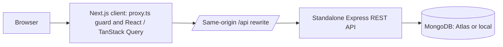

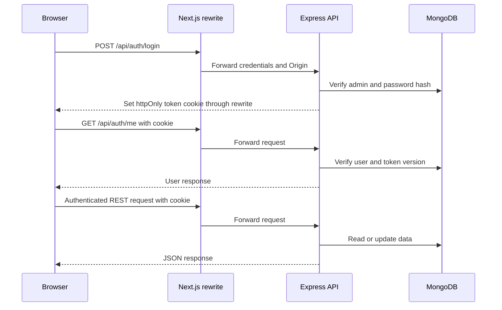

The rewrite keeps browser requests on the frontend origin, making the cookie first-party in this topology. `proxy.ts` only checks for cookie presence as an optimistic navigation guard. `AuthGuard` verifies the session through `/auth/me`; the API verifies every protected request. The API client emits a global expiry event on relevant 401 responses, clears cached data, and navigates to login. The backend must allow the browser's Origin.

TanStack Query caches server state, keeps previous list data during page changes, and invalidates affected lists, details, and dashboard queries after mutations. List filters, sorting, and pagination are synchronized with URL search parameters so views can be linked and revisited.

## Project structure

```text
src/
  app/          App Router pages and layouts
  components/   authentication, layout, and shared UI
  features/     dashboard, doctors, patients, and shared feature code
  hooks/        authentication and URL parameter hooks
  lib/          API client, configuration, auth and utilities
  providers/    query, session, and toast providers
  types/        shared client types
```

## Technical decisions

### TanStack Query and URL filters

**Context:** Lists need asynchronous fetching, pagination, cache refresh, and shareable filters. **Options:** Redux could centralize all state; Context could pass it through the component tree; either would require additional server-cache and synchronization logic. **Decision:** TanStack Query owns server responses while URL parameters own list filters. Mutations invalidate related queries. **Trade-offs:** Query keys and invalidation must stay consistent, and URLs expose filter values; in return, links preserve the view and the application avoids a second general-purpose state store.

### Same-origin rewrite and httpOnly cookie

**Context:** The browser must authenticate against a separately hosted API. **Options:** JavaScript-managed localStorage bearer tokens are convenient but accessible to injected scripts; direct cross-site cookies require browser and CORS compatibility. **Decision:** Next.js rewrites `/api` to Express and the backend sets an httpOnly cookie. **Trade-offs:** The proxy and backend origin allow-list must be configured correctly, and cookie authentication still requires CSRF and XSS defenses. The presence guard is deliberately not authorization; Express validates the token and role.

## Visual evidence

Screenshots use the masked address `admin@example.com`.

| View              | Desktop                                                                | Mobile                                                                       |
| ----------------- | ---------------------------------------------------------------------- | ---------------------------------------------------------------------------- |
| Login             | 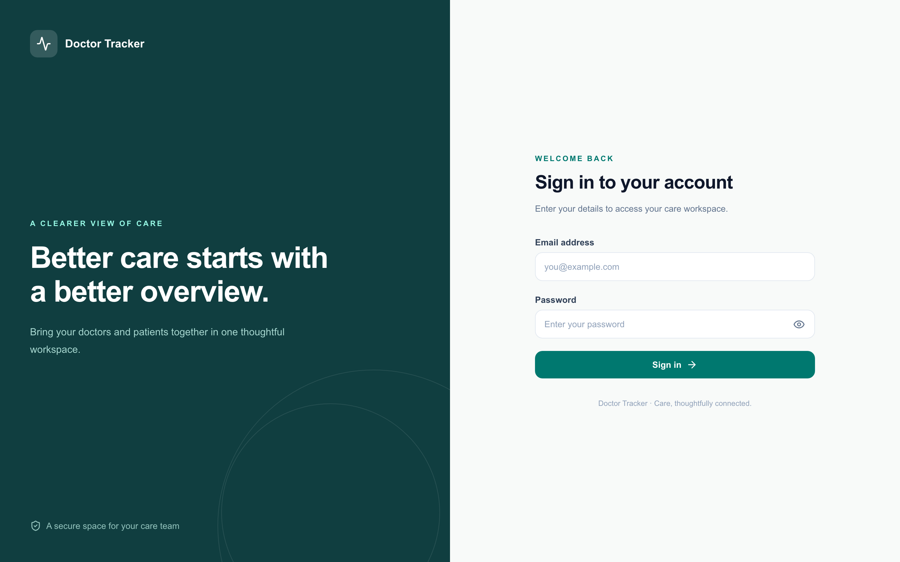                 | 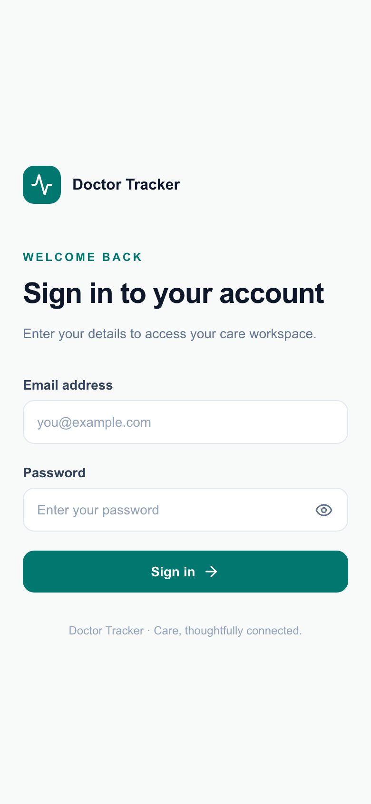                         |
| Dashboard         | 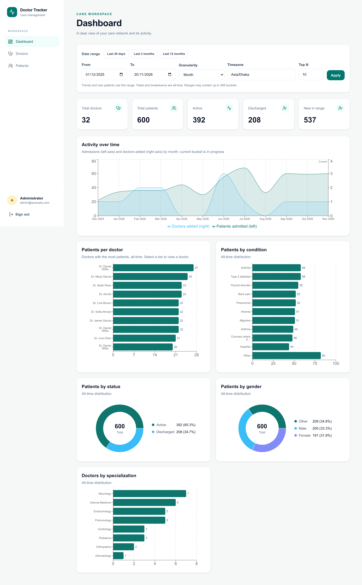         | 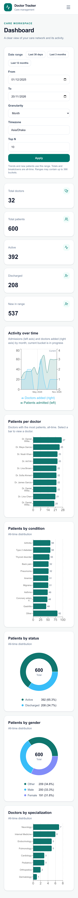                 |
| Doctors           | 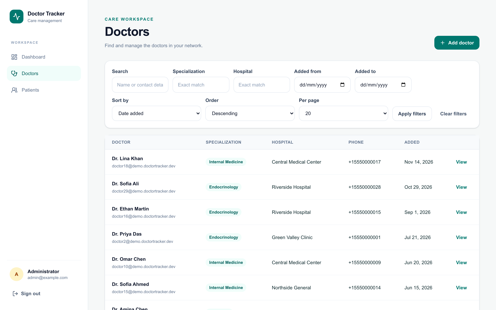             | 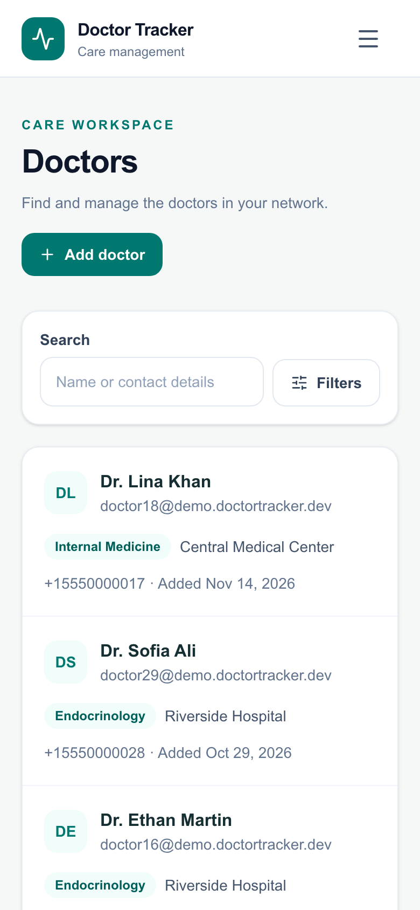                     |
| Doctor detail     | 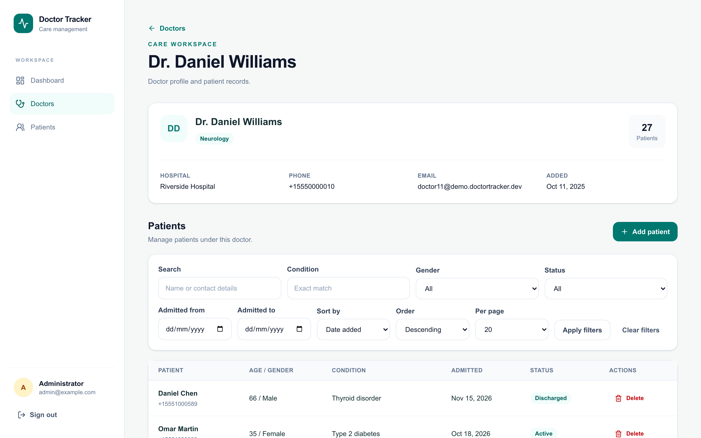 | 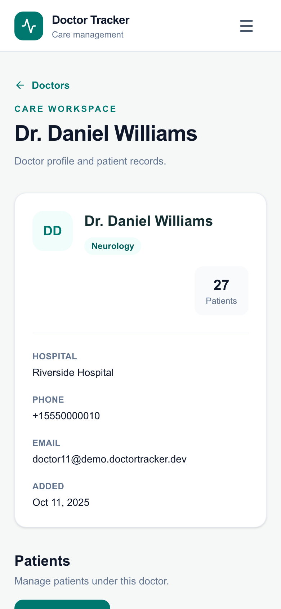         |
| Patients          | 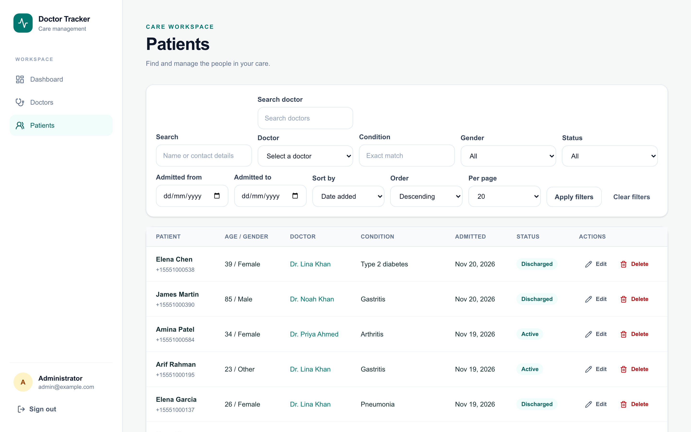           | 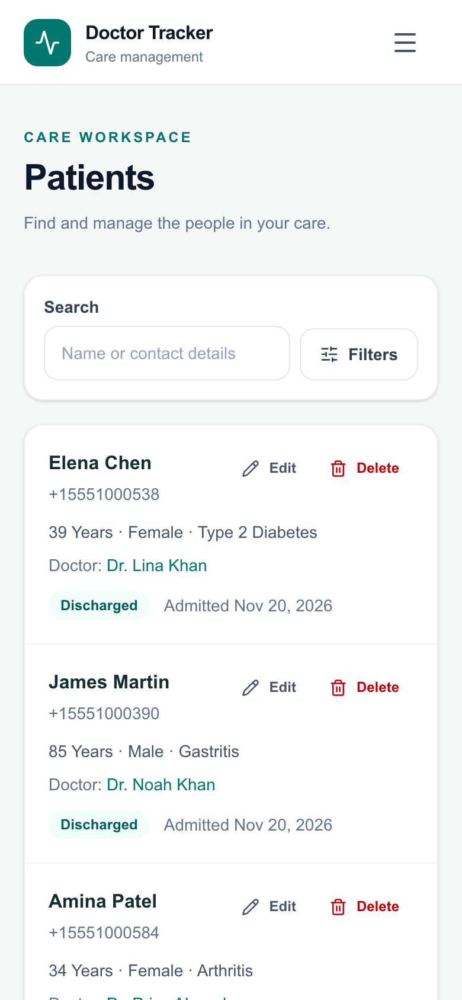                   |
| Edit patient      | 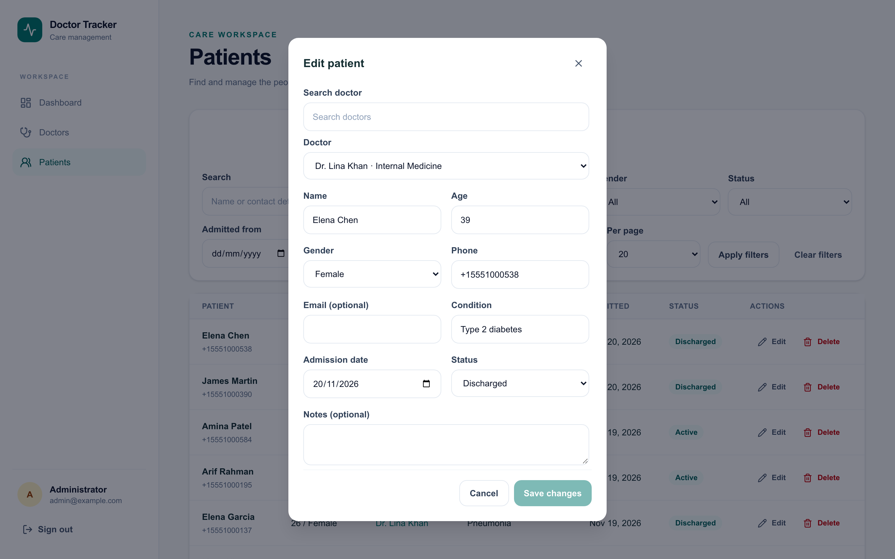   | 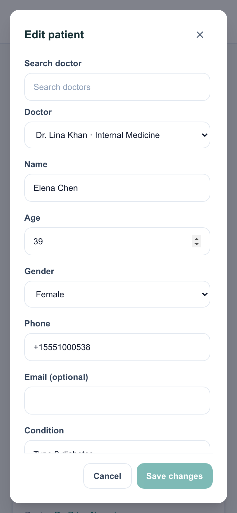           |
| Navigation drawer | —                                                                      | 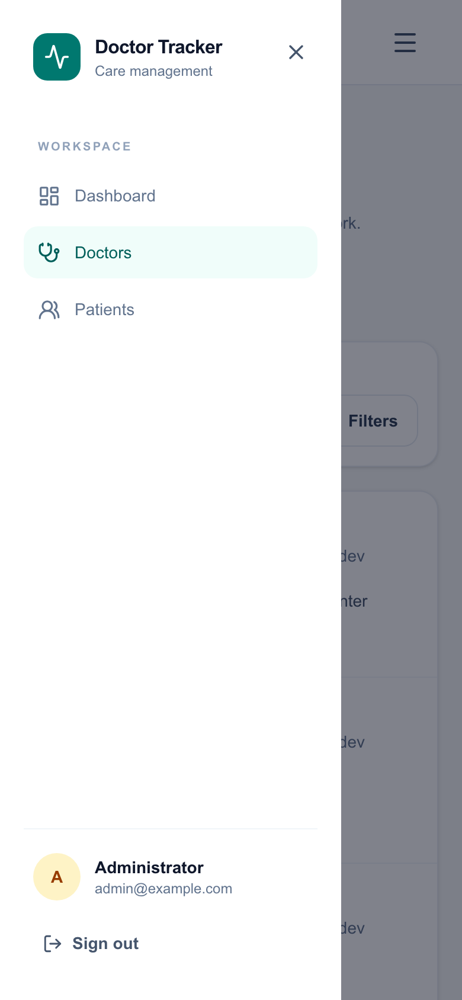 |

## Known limitations

- Only the admin role is supported; doctors cannot be edited or deleted.
- Specialization, hospital, and condition filters are exact matches (case-insensitive); search is separate.
- A patient's email cannot be cleared once set.
- Dashboard breakdowns are all-time; trends and new-patient counts use the selected range.
- Logging out revokes all sessions for that admin.

## Submission credentials

Reviewer credentials are provided separately with the submission and must not be committed.
